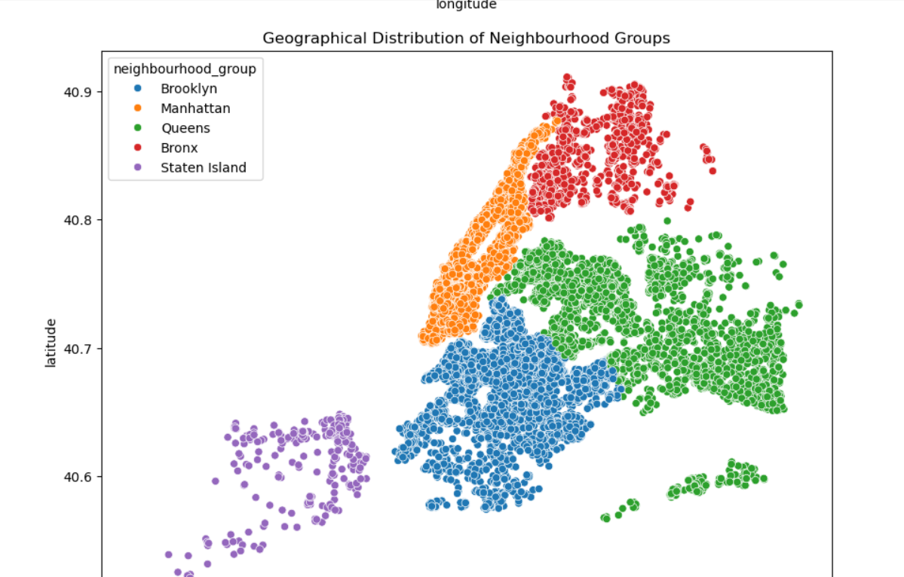
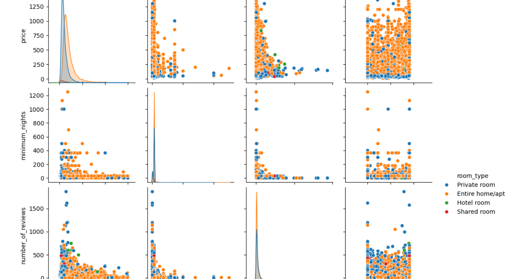

# 🏙️ Airbnb New York City: Data Analysis and Visualization

## 📌 Project Overview

This project presents an exploratory data analysis (EDA) of the **Airbnb New York City** dataset to uncover trends in pricing, availability, room types, and geographical distribution of listings.

The analysis focuses on identifying factors that influence listing prices and availability while providing data-driven recommendations for both Airbnb hosts and travelers.

**Tools Used:** Python (Pandas, NumPy, Matplotlib, Seaborn), Jupyter Notebook, and Power BI.

---

## 🔍 Key Insights

### 💰 Pricing Trends
- Most Airbnb listings are priced below **$250 per night**.
- The price distribution is **right-skewed**, with a small number of premium listings acting as outliers.

### 🏠 Room Type Distribution
- **Entire home/apartment** is the most common room type.
- **Private rooms** are the second most common option.
- **Shared rooms** and **Hotel rooms** make up only a small percentage of listings.

### 🗺️ Geographical Distribution
- **Brooklyn** and **Manhattan** have the highest concentration of Airbnb listings.
- These boroughs represent the most competitive Airbnb markets.

### 💲 Average Price by Borough
- **Manhattan** has the highest average listing price.
- **Brooklyn** follows as the second most expensive borough.
- **Queens**, **Bronx**, and **Staten Island** provide more affordable accommodation options.

### 🏘️ Top Neighborhoods by Listings
- Williamsburg
- Bedford-Stuyvesant
- Harlem

---

# 💡 Recommendations

## 🧑‍💼 For Hosts
- Use competitive pricing strategies based on nearby listings.
- Entire homes/apartments generally generate higher revenue.
- Invest in high-demand neighborhoods for better occupancy and profitability.

## 🧳 For Travelers
- Consider Queens, Bronx, or Staten Island for budget-friendly stays.
- Private rooms provide good value for solo travelers and couples.
- Book early when planning stays in Manhattan or Brooklyn due to high demand.

---

# 📂 Dataset Summary

- **Total Listings:** 20,461
- **Total Features:** 33

---

## 🧾 Key Features

| Column | Description |
|---------|-------------|
| id | Unique listing identifier |
| name | Listing title |
| host_id | Unique host identifier |
| neighbourhood_group | Borough (Brooklyn, Manhattan, etc.) |
| neighbourhood | Specific neighborhood |
| latitude, longitude | Geographic coordinates |
| room_type | Type of accommodation |
| price | Price per night (USD) |
| minimum_nights | Minimum stay required |
| number_of_reviews | Number of customer reviews |
| availability_365 | Number of available days per year |
| rating | Overall customer rating |
| bedrooms, beds, baths | Property details |

---

# ⚙️ Methodology

## 🧹 Data Cleaning & Preprocessing
- Removed missing values from important columns.
- Removed duplicate records.
- Converted inconsistent string values into numeric format.
- Created a **license_status** feature for binary classification.

## 📊 Exploratory Data Analysis
- Performed univariate analysis using histograms and count plots.
- Conducted bivariate analysis using box plots and bar charts.
- Visualized Airbnb listing density using geospatial mapping.

---

# 🧰 Technologies Used

| Purpose | Tools |
|----------|-------|
| Data Cleaning & Analysis | Pandas, NumPy |
| Data Visualization | Matplotlib, Seaborn |
| Database | MySQL |
| Interactive Dashboard | Power BI |
| Development Environment | Jupyter Notebook |

---

# 📸 Project Screenshots

> Add screenshots of your visualizations here.

### Power BI Dashboard

### Geographic Distribution

### room type

---

---
